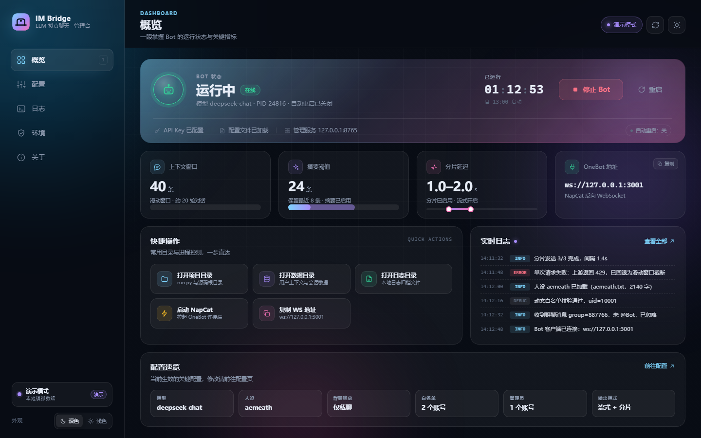
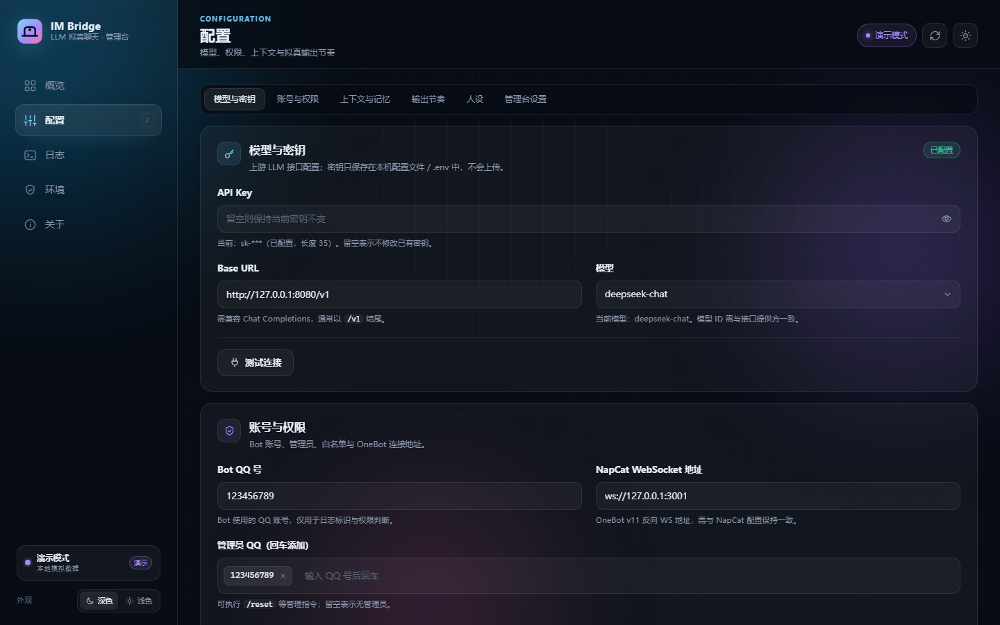
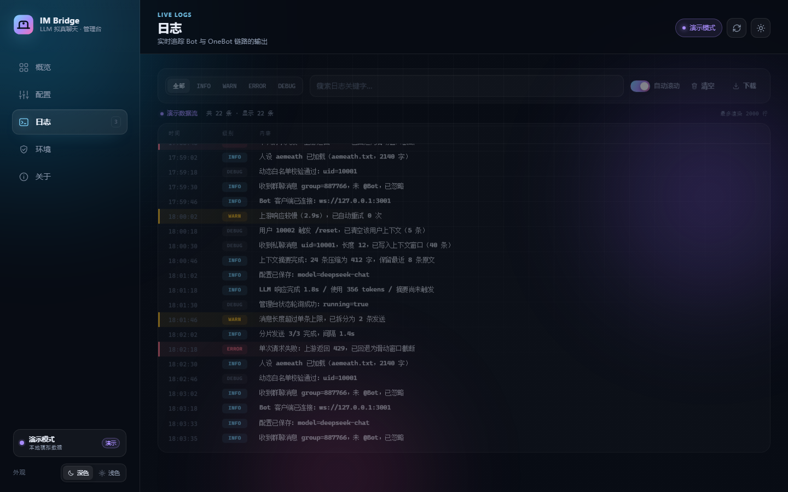
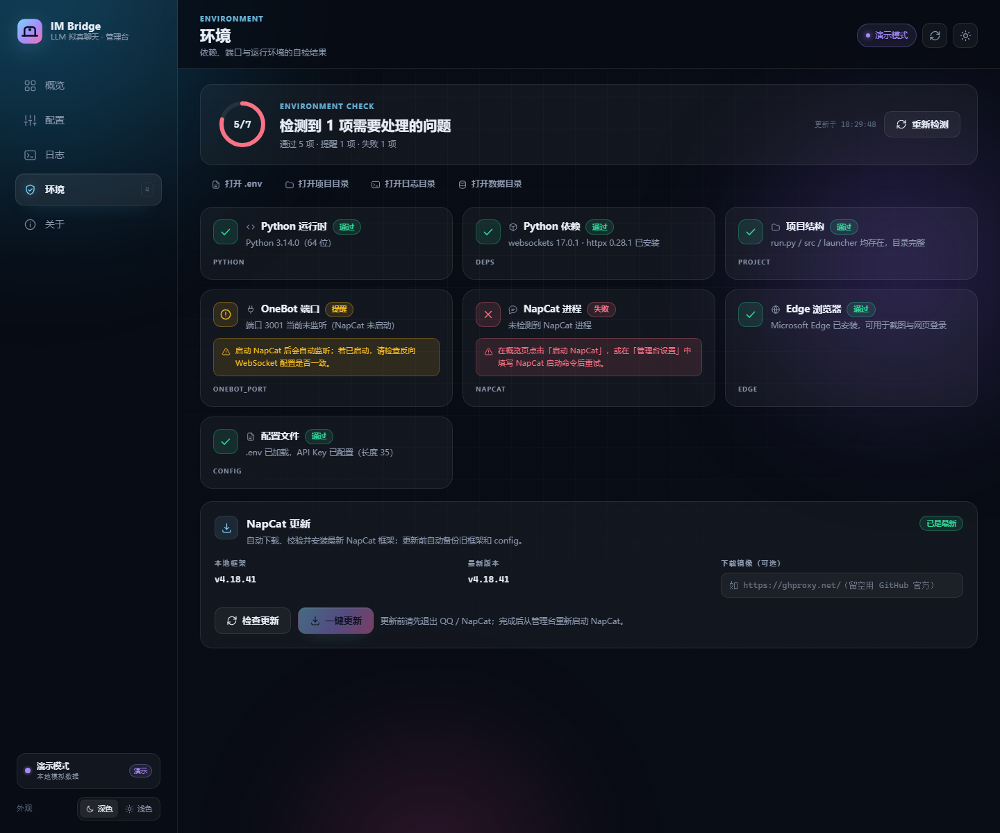
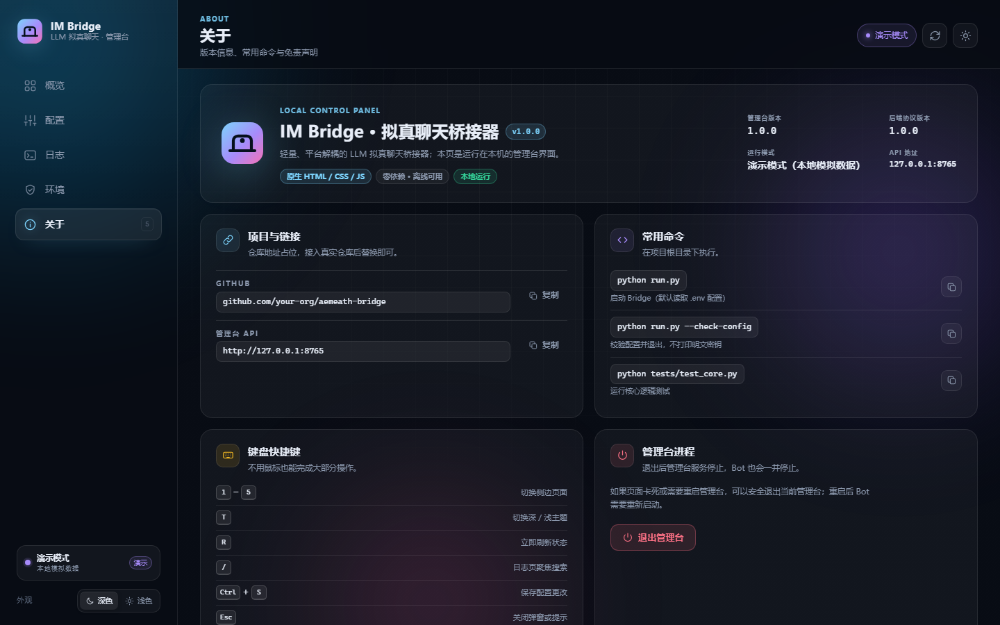

# BotManager 管理台

本地图形化管理台：一键启动/停止 bot、可视化编辑配置（API Key、模型、权限、拟真输出参数）、实时查看日志、环境自检。基于 Python 标准库实现本地 HTTP 服务，前端为原生 HTML/CSS/JS（无框架、离线可用），用 Edge 应用窗口打开，也可打包为单文件 `BotManager.exe`。

## 快速使用

### 方式一：双击 exe（推荐）

```
BotManager.exe
```

首次使用需先构建（见下文「构建 exe」），或直接使用仓库 Release 中的 `BotManager.exe`。

### 方式二：从源码启动

```powershell
python launcher\launcher.py
```

常用参数：

```powershell
python launcher\launcher.py --no-browser   # 只启动服务，不打开窗口
python launcher\launcher.py --open         # 打开已在运行的实例
python launcher\launcher.py --check        # 打印环境自检 JSON 后退出
python launcher\launcher.py --port 8790    # 指定端口（默认 8765，被占用时自动顺延）
```

管理台启动后默认监听 `http://127.0.0.1:8765`，并用 Edge 的应用窗口（无地址栏）打开。

## 功能

- **一键启停**：启动 / 停止 / 重启 bot，显示 PID、运行时长、退出码；可选自动重启。
- **配置管理**：API Key（密码框、一键测试连通性并显示延迟与模型列表）、Base URL、模型预设、Bot QQ、管理员/白名单（标签输入）、上下文与摘要参数、流式/分片开关、分片延迟、人设。
- **实时日志**：SSE 推送，级别筛选、搜索、自动滚动、清空、下载；bot 退出与异常一目了然。
- **环境自检**：Python 运行时、依赖、配置有效性、OneBot 端口、NapCat、Edge 应用窗口逐项检测并给出修复建议。
- **NapCat 自动更新**：环境页可检查最新版本并一键更新——自动下载（支持镜像源）、SHA256 校验、备份旧框架与 config、解压覆盖，无需手动去 GitHub 下载。更新前请先退出 QQ / NapCat。
- **快捷操作**：打开项目/数据/日志目录，一键启动 NapCat（需先配置启动命令）。
- **退出管理台**：页面右上角「退出管理台」会同时停止 bot，避免进程残留。

配置写入规则（与 bot 核心保持一致）：

- API Key 只写入 `.env`（被 `.gitignore` 忽略），不会写入 `config.json`；
- 其余配置写入 `config.json`，并清理 `.env` 中的同名 `AMIS_*` 覆盖项；
- 读取优先级：进程环境变量 > `.env` > `config.secret.json` > `config.json` > 默认值。

## 界面预览

以下截图取自 `?demo=1` 演示模式（数据为模拟值，不含任何真实账号信息）：

| 概览 | 配置 |
| --- | --- |
|  |  |
| **实时日志** | **环境自检** |
|  |  |

关于页展示版本信息与常用命令：

## 构建 exe

在项目根目录执行：

```powershell
python launcher\build_exe.py
# 或双击 build_manager.bat
```

脚本会：

1. 在 `.build/venv` 中创建独立构建环境并安装 PyInstaller；
2. 打包 `launcher/launcher.py`（内置 `launcher/web/` 静态资源与图标）；
3. 输出 `BotManager.exe` 到项目根目录。

需要能访问 PyPI 安装 PyInstaller。构建产物 `.build/`、`BotManager.exe` 均已被 `.gitignore` 忽略，可随时重建。

## 目录结构

```
launcher/
├── launcher.py        # 入口：单实例探测、启动服务、打开 Edge 窗口
├── server.py          # HTTP 服务 + JSON API + SSE
├── bot_manager.py     # bot 子进程管理、日志缓冲与广播
├── config_store.py    # .env / config.json 读写、校验（复用核心 Config）
├── env_check.py       # 环境自检、NapCat/Edge 集成、打开目录
├── build_exe.py       # 构建脚本
├── assets/            # 图标（由 make_icon.py 生成）
└── web/               # 前端（index.html / styles.css / app.js）
```

界面截图（演示模式）位于仓库根目录 `docs/screenshots/`。

## API 概览

| 方法 | 路径 | 说明 |
| --- | --- | --- |
| GET | `/api/state` | bot 状态 + 配置摘要（前端每 2 秒轮询） |
| GET/POST | `/api/config` | 读取/保存配置（`api_key` 为空表示不修改） |
| POST | `/api/config/test` | 测试 LLM 连通性（优先 `/models`，失败回退最小 chat 请求） |
| POST | `/api/bot/start` `/stop` `/restart` | 启停 bot |
| POST | `/api/bot/auto-restart` | 自动重启开关 |
| GET | `/api/logs?tail=400` | 日志快照 |
| GET | `/api/logs/stream` | SSE 实时日志 |
| GET | `/api/env?refresh=1` | 环境自检 |
| POST | `/api/settings` | 管理台设置（NapCat 启动命令等） |
| POST | `/api/napcat/start` `/stop` | 启动/停止 NapCat |
| POST | `/api/action/open` | 打开项目/数据/日志/.env |
| POST | `/api/shutdown` | 停止 bot 并退出管理台 |

服务只监听 `127.0.0.1`，并校验请求 `Origin`，不会被外部网页调用。

## 多实例（3.0+）

一个管理台可以同时管理多个 QQ 号，每个实例拥有独立的配置、人设、数据与日志。

### 目录布局

```
instances.json                 # 实例注册表
instances/<id>/config.json     # 该实例的业务配置
data/<id>/                     # 该实例的数据（状态、摘要、日志）
.env / config.secret.json      # 所有实例共享的密钥
backups/instances/             # 删除实例时的备份
```

`default` 实例是特殊的存在：它直接引用根目录的 `config.json` 与 `data/`，
所以从 2.x 升级上来的老用户不需要做任何迁移。

### 新增一个实例

1. 打开管理台 →「实例」页 →「新建实例」
2. 填写 ID（只允许小写字母、数字、`_`、`-`）、QQ 号、人设、OneBot 地址
3. 准备一个**独立的 NapCat** 并监听对应端口（见下）
4. 在该实例卡片上点「启动」

也可以直接命令行起一个实例（不经过管理台）：

```bash
python run.py --instance bot2
```

### 实例 ↔ NapCat ↔ 端口

**一个 NapCat 只能登录一个 QQ。** 多账号时每个号需要一个独立容器与端口：

| 实例 | QQ | NapCat 端口 | OneBot 地址 |
|---|---|---|---|
| default | 123456789 | 3001 / 6099 | `ws://127.0.0.1:3001` |
| bot2 | 987654321 | 3002 / 6100 | `ws://127.0.0.1:3002` |

管理台只负责保存 OneBot 地址，**不做容器编排**——NapCat 的启动、扫码、端口映射需要自己准备。

### 资源与风控

- 每个实例约 100–200 MB（Python 进程）+ 500 MB 以上（NapCat 容器）
- 2 GB 内存的机器实际只够跑 1–2 个实例
- 同一个公网 IP 挂多个 QQ 有风控风险，建议小规模自用

### 删除实例

删除前需要先「停止」，否则会拒绝。配置与数据会**移动到** `backups/instances/<id>-<时间戳>/`
而不是直接删除，需要彻底清理时手动处理该目录。

### 云服务器上的托管方式（重要）

云端是长期在线场景，**bot 必须由 systemd 保活，而不是管理台的子进程**。否则管理台一更新，
所有非 default 实例都会跟着被杀掉。

每个实例对应一个 systemd 单元：

| 实例 | 单元名 | 启动命令 |
|---|---|---|
| default | `im-bridge.service` | `run.py`（不带参数） |
| 其它 | `im-bridge@<id>.service` | `run.py --instance <id>` |

模板单元（只需建一次）：

```ini
# /etc/systemd/system/im-bridge@.service
[Unit]
Description=IM Bridge Bot Instance %i (QQ <-> LLM)
After=network-online.target docker.service
Wants=network-online.target

[Service]
Type=simple
WorkingDirectory=/opt/im-bridge
ExecStart=/opt/im-bridge/.venv/bin/python run.py --instance %i
Restart=always
RestartSec=5
Environment=PYTHONUNBUFFERED=1
NoNewPrivileges=true

[Install]
WantedBy=multi-user.target
```

```bash
systemctl daemon-reload
systemctl enable --now im-bridge@bot2   # 首次启动时管理台会自动 enable
```

架构分层：

```
systemd    保活、开机自启、崩溃拉起（PPID=1）
管理台     配置、启停指令、状态展示、日志查看（控制面）
NapCat     每实例独立容器 + 独立端口
LLM        共享密钥（根 .env）
```

管理台通过 `/api/instances/<id>/start|stop|restart` 下发 `systemctl` 指令，
自身重启不会影响任何 bot 进程。

### 常见问题

**实例列表显示「已停止」，但 bot 明明在跑**
云服务器上如果 bot 由 systemd 托管（`systemctl status im-bridge`），管理台只是观察者。
`default` 实例会自动读 systemd 状态；其它实例如果是手动/systemd 启动的，管理台看不到，
需要在管理台里启动，或把它交给管理台管理。

## 常见问题

- **双击 exe 没反应**：首次启动 PyInstaller 单文件程序需要解压，约 2~4 秒；若仍无反应，查看 `data/launcher.log`。
- **窗口没弹出来**：管理台会优先用 Edge `--app` 打开；若未安装 Edge 则退化为默认浏览器。可手动访问 `http://127.0.0.1:8765`。
- **端口被占用**：默认从 8765 起自动顺延，也会复用已在运行的实例窗口。
- **NapCat 一键启动**：需在「配置 → 管理台设置」填写启动命令。新版 NapCat（bootmain 启动器）通常为：
  `"D:\NapCatQQ\bootmain\NapCatWinBootMain.exe"`
  管理台启动前会校验命令中的可执行文件是否存在，不存在会直接报错；若使用旧版 apimain 方式，请确认路径真实存在。
- **Bot 运行中但收不到消息**：概览页会提示「OneBot 未连接」，说明 NapCat 未启动或端口与 `AMIS_NAPCAT_WS_URL` 不一致。启动 NapCat 并确认 3001 端口监听后，bot 会在 15 秒内自动重连。
- **API Key 测试失败**：确认 Key 未过期/未被回收、Base URL 指向 OpenAI 兼容端点；DeepSeek 可在控制台重新生成。
- **退出后 bot 还在跑**：通过管理台「退出管理台」会先停止 bot；若直接结束进程，请手动结束 `python.exe run.py`。
